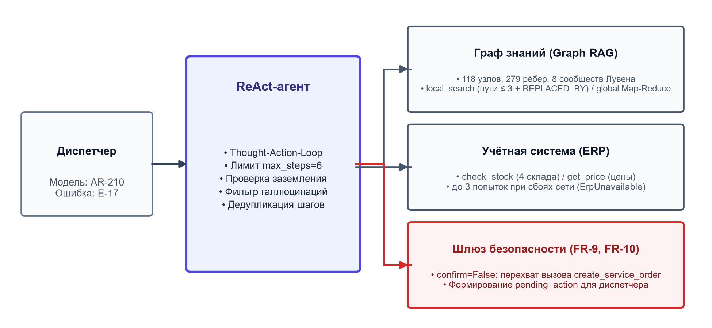
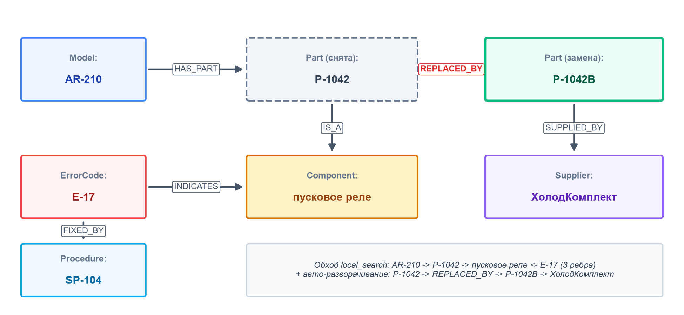
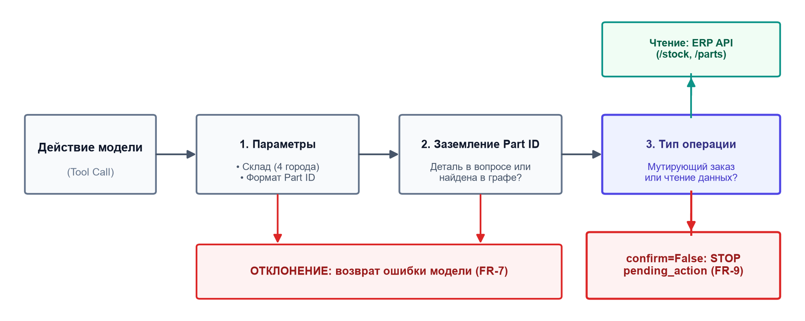

# Отчёт: Ассистент сервисной службы «ПолярТех»

**Репозиторий проекта:** [https://github.com/Xplous/llm-project](https://github.com/Xplous/llm-project)  
**Используемая модель LLM:** `qwen3:4b-instruct-2507-q4_K_M` (Ollama, CUDA GPU NVIDIA RTX 4070 SUPER)  
**Эмбеддинги:** `bge-m3`  
**Метка версии:** `v1.0`  
**Итоговый PDF:** [`REPORT.pdf`](REPORT.pdf)

---

## 1. Задача

Компания «ПолярТех» обслуживает коммерческое и промышленное холодильное оборудование (витрины, моноблоки, чиллеры). Диспетчер сервисной службы принимает вызовы от клиентов, сообщающих модель оборудования и код ошибки (например, «AR-210, код E-17»).

**Цель ассистента:**
1. Оперативно определить причину неисправности, регламент ремонта и актуальную деталь (с учётом снятия деталей с производства и цепочек замен `REPLACED_BY`).
2. Проверить реальные складские остатки (по 4 складам: Москва, Санкт-Петербург, Казань, Новосибирск) и цены в учётной системе (ERP).
3. Подготовить сервисный заказ с обязательным подтверждением человеком (диспетчером).

### Почему плоский RAG (Flat RAG) не справляется
1. **Многошаговые замены (`dev-06`):** на вопросе *«Какую деталь заказать при ошибке E-17 на AR-210?»* плоский RAG находит `manual_AR-210.md` и отвечает устаревшей деталью `P-1042`, не переходя по сервисному бюллетеню `bulletin_SB-2025-03.md` к актуальной замене `P-1042B`.
2. **Оперативные данные ERP (`dev-17`, `dev-20`):** на вопросе *«Сколько штук детали P-1118B есть на складе в Казани?»* плоский RAG получает точность **0.00**, поскольку складские остатки и цены отсутствуют в статических документах и доступны только через API ERP. Агент вызывает `check_stock(part_id="P-1118B", warehouse="Казань")` и возвращает фактический остаток.

---

## 2. Архитектура решения и ReAct-конвейер

Система объединяет три взаимодействующих контура, реализованных строго по требованиям FR-1 — FR-10:

1. **Извлечение и Граф знаний (FR-1, FR-2):**
   - `extraction.py` извлекает сущности и типизированные связи по строгой JSON Schema (`EXTRACTION_SCHEMA`) с `max_tokens=4096` и 4 синтетическими few-shot примерами (руководство с несколькими узлами, бюллетень, регламент, отчёт о выезде) без утечки эталона `gold_dev.json`.
   - Заземление (Grounding): коды сверяются с исходным чанком (`find_codes`), названия нормализуются по словарю (`canonical_name`), а для плановых регламентов без связей изолированные узлы `Procedure` не добавляются.
   - `graph_builder.py` объединяет результаты в `nx.DiGraph`, фиксирует источники на обоих концах ребра и разрешает взаимные циклы `REPLACED_BY` по весу.
2. **Сообщества и Поиск по графу (FR-3, FR-4, FR-5):**
   - `communities.py` разбивает граф алгоритмом Лувена (`seed=7`) на 8 сообществ. Для сообществ с линейками оборудования код детерминированно подсчитывает лидеров отказов и цепочки снятых деталей, а для тематических сообществ без линеек запрещает придумывать «линейки» и «лидеров».
   - `local_search`: находит пути длиной $\le 3$ между опорными узлами (или 2-hop окрестность при 1 якоре), автоматически разворачивает цепочки `REPLACED_BY` вместе со связями `SUPPLIED_BY` и `IS_A`, и мгновенно отказывает (`refused=True`) без вызова LLM при неизвестном коде.
   - `global_search`: проверяет неизвестные коды до запуска цикла, затем выполняет Map-Reduce (`MAP_SCHEMA`, сортировка по `score > 0`) по сводкам сообществ.
3. **Инструменты и ReAct-агент (FR-6 — FR-10):**
   - `tools.py` предоставляет 5 типизированных инструментов с валидацией аргументов (4 склада ERP, формат кода детали).
   - `agent.py` ведёт ReAct-цикл (`max_steps=6`), нормализует коды, проверяет заземление деталей и чисел, выполняет до 3 попыток при `ErpUnavailable` и перехватывает `create_service_order` при `confirm=False` в `pending_action`.



---

## 3. Результаты и сравнительный бенчмарк

Оценка проводилась на 24 вопросах `questions_dev.jsonl` (`temperature=0`, `seed=7`, чистый кеш `artifacts/llm_cache/`).

### Сводная таблица четырёх режимов

| Метрика | Baseline (Flat RAG) | Local Search (Graph RAG) | Global Search (Graph RAG) | Agent (Граф + ERP) |
| :--- | :---: | :---: | :---: | :---: |
| **Общая точность (Accuracy)** | **0.500** (12/24) | **0.792** (19/24) | **0.417** (10/24) | **0.917** (22/24) |
| • Вопросы `local` (5) | 1.000 (5/5) | **1.000** (5/5) | 0.800 (4/5) | **1.000** (5/5) |
| • Вопросы `multihop` (7) | 0.571 (4/7) | **1.000** (7/7) | 0.143 (1/7) | **1.000** (7/7) |
| • Вопросы `global` (4) | 0.000 (0/4) | **1.000** (4/4) | 0.500 (2/4) | **0.750** (3/4) |
| • Вопросы `tool` (5) | 0.000 (0/5) | 0.000 (0/5) | 0.000 (0/5) | **0.800** (4/5) |
| • Вопросы `refusal` (3) | 1.000 (3/3) | **1.000** (3/3) | **1.000** (3/3) | **1.000** (3/3) |
| **Выдуманные факты (Fabricated)** | **0.000** | 0.042* | 0.042 | 0.042 |
| **Полнота источников (Source Recall)** | 0.856 | **1.000** | 0.719 | **1.000** |
| **Отклонённые вызовы инструментов** | — | — | — | **0.032** |
| **Вызовов модели на вопрос** | 1.00 | **0.88** | 7.67 | 4.83 |
| **Токенов на вопрос** | 1356.7 | **1113.5** | 3887.9 | 5130.4 |

*\*В режиме `local` единственное срабатывание (`dev-21`: `['2 шт']`) — это повтор числа «2 штуки» из формулировки вопроса пользователя; подробнее в разделе 5.*


### Метрики извлечения (`eval_extraction.json`, 16 эталонных документов `gold_dev.json`)
- **Связи (Relations):** Precision = **1.000**, Recall = **1.000** (161 из 161)
- **Сущности (Entities):** Precision = **1.000**, Recall = **1.000** (165 из 165)
- **Отброшено проверками заземления (`dropped`):** **0**

### Параметры графа и стоимость индексации (`index_stats.json`)
- Документов корпуса: **80** (**92** чанка)
- Узлов графа: **118**, Рёбер графа: **279**, Сообществ Лувена: **8**
- Отброшено при индексации (`dropped`): **0**, Разрешённых конфликтов: **0**
- Затраты LLM: **100** вызовов (**20** попаданий в кеш), **228 614** prompt-токенов, **40 812** completion-токенов.

---

## 4. Где граф помогает и где уступает

### Пример 1. Преимущество Графа и Агента (`dev-06`, `dev-17`, `dev-22..24`)
- **Вопрос `dev-06` / `dev-17`:** *«Ошибка E-17 на AR-210. Какую деталь заказать, есть ли она на складе в Казани и сколько она стоит?»*
  - **Плоский RAG:** Останавливается на устаревшей детали `P-1042` из руководства и не имеет доступа к ERP (`Accuracy = 0.00`).
  - **Граф (`local_search`) + Агент:** Граф находит путь `AR-210 -> P-1042 -> пусковое реле <- E-17` и автоматически разворачивает цепочку `P-1042 -> REPLACED_BY -> P-1042B -> SUPPLIED_BY -> ХолодКомплект`. Затем агент запрашивает ERP (`check_stock` -> 3 шт., `get_price` -> 2630 руб.) и выдаёт полный верный ответ.
- **Вопросы `dev-22..24` (`refusal`):** `local_search` и `global_search` проверяют наличие кода в графе до вызова LLM и мгновенно возвращают отказ (`0` вызовов модели, `0` токенов), тогда как плоский RAG тратит ~1357 токенов на каждый отказ.

### Пример 2. Где граф уступает или проигрывает по цене (`dev-01..05`, `dev-14`)
- **Простые однохоповые вопросы (`dev-01..05`, `local`):** плоский RAG даёт те же **100% (5/5)** точности за 1 вызов модели без затрат на предварительную графовую индексацию (269 тыс. токенов), тогда как Агент тратит в среднем 4.83 вызова и 5130 токенов на вопрос, а `global_search` — 7.67 вызова и 3888 токенов (при точности 0.80 на `local`).
- **Вопрос `dev-14` (`global`):** *«Какой узел чаще всего отказывает в линейке «Гольфстрим»?»* — при маршрутизации через `summarize_topic` (Map-Reduce) модель `qwen3:4b` в шаге reduce перепутала модель-лидер (`GS-510`, 4 отказа) с узлом-лидером (`циркуляционный насос`, 8 отказов), тогда как прямой `local_search` по подграфу линейки ответил верно.



---

## 5. Анализ ошибок системы и оптимизация

Были исследованы ошибки на всех трёх этапах конвейера:

1. **Этап извлечения (`extraction.py`) — диагностировано и устранено:**
   - *Сбой 1 (усечение JSON):* лимит `max_tokens=1024` обрывал JSON на длинных руководствах -> увеличение до `4096` подняло Recall связей с `0.329` до `0.590`.
   - *Сбой 2 (1-пунктовый пример):* при одном пункте в few-shot примере модель на 5 из 12 руководств (`AR-310`, `AR-320`, `BZ-210`, `GS-510`, `GS-520`) извлекала лишь первую деталь (`P-1110`, `P-2110`, `P-3110`). Добавление второго пункта в синтетический пример и явного правила извлечения всех строк подняло качество до **Precision 1.000 / Recall 1.000** и увеличило граф до **279 рёбер**.

### Таблица эволюции извлечения («Было / Стало»)

| Параметр | `max_tokens=1024` | `max_tokens=4096` (1 пример) | 4 синтетических примера (финал) |
| :--- | :---: | :---: | :---: |
| **Связи: Precision / Recall** | 1.000 / 0.329 | 1.000 / 0.590 | **1.000 / 1.000** |
| **Число рёбер графа** | 50 | 125 | **279** |
| **Отброшено (`dropped` на эталоне)** | 12 | 38 | **0** |

2. **Этап сообществ и поиска (`communities.py`, `search.py`):**
   - *Проблема в `global_search`:* при едином промпте сводок тематическое сообщество компрессора (без `ProductLine`) выдумывало «узел-лидер E-11 (вес 14)» и перебивало реальные линейки. Разделение промпта на сообщества с линейками и без них устранило шум, но на `dev-14` (`summarize_topic`) модель всё ещё склонна путать модель-лидер (`GS-510`) с узлом-лидером (`циркуляционный насос`).
   - *Нюанс метрики `fabricated` в режиме `local`:* на `dev-21` ответ повторяет «2 штуки» из текста вопроса; поскольку `evaluation.py` проверяет числа с единицами (`\d+ шт`) только по `step.result` (которых у `local` нет), это фиксируется как `fabricated = ['2 шт']` (`0.042`).
3. **Этап агента и инструментов (`agent.py`):**
   - *Проявление 1 (`dev-21`):* агент верно нашёл `P-2054C`, проверил остаток в Москве (`6 шт.`) и цену (`6750 руб.`), но вместо вызова `create_service_order` сформировал текстовый ответ с расчётной суммой и «2 шт.». Встроенный барьер `_find_discrepancies` дважды перехватил неподтверждённые числа и безопасно перевёл ответ в отказ (`refused=True`), не допустив ложного подтверждения заказа.
   - *Проявление 2 (`dev-12`):* при верном ответе (`P-1118B`, `ТермоПрибор`) модель указала неверный код регламента `SP-205` вместо `SP-105` — это единственный реальный случай галлюцинации кода у агента (`fabricated_rate = 0.042`).

---

## 6. Границы системы и безопасность (FR-9, FR-10)

Система реализует архитектурный барьер контроля человека (Human-in-the-Loop):

1. **Остановка перед мутацией ERP (FR-9):** при `confirm=False` вызов `create_service_order` перехватывается до обращения к ERP и **не записывается** в выполненные шаги; возвращаются `needs_confirmation=True` и `pending_action` с параметрами заказа (`part_id`, `warehouse`, `qty`, `model`). Фактическое создание заказа выполняется только при `--confirm`.
2. **Валидация аргументов и заземление (FR-7, FR-10):**
   - Код детали `part_id` должен встречаться в вопросе или результатах `search_knowledge`; количество `qty` — в вопросе пользователя.
   - Склад проверяется по закрытому списку **4 складов**: `Москва`, `Санкт-Петербург`, `Казань`, `Новосибирск`.
   - При сбоях сети (`ErpUnavailable`) выполняются до 3 попыток; ответы чётко различают «нет данных» и «остаток 0».



### Реальная трассировка агента из `eval_agent.json` (`dev-17`) и шлюз подтверждения
```text
Диспетчер: «Ошибка E-17 на AR-210. Какую деталь заказать, есть ли она на складе в Казани и сколько она стоит?»
  1. search_knowledge({'question': 'Ошибка E-17 на AR-210'})
     -> узел «пусковое реле», P-1042 заменена на P-1042B (ХолодКомплект), регламент SP-104
  2. check_stock({'part_id': 'P-1042B', 'warehouse': 'Казань'})
     -> {'part_id': 'P-1042B', 'warehouse': 'Казань', 'qty': 3, 'discontinued': False}
  3. get_price({'part_id': 'P-1042B'})
     -> {'part_id': 'P-1042B', 'name': 'пусковое реле', 'price_rub': 2630, 'discontinued': False}
Ответ: «Для устранения ошибки E-17 на AR-210 необходимо заменить деталь P-1042B (пусковое реле).
        Склад: Казань, остаток: 3 шт., цена: 2630 руб.»

При запросе создания заказа (confirm=False):
  [Safety Gate] create_service_order(part_id='P-2054C', warehouse='Москва', qty=2, model='BZ-120')
  -> needs_confirmation=True, pending_action={'tool': 'create_service_order', 'args': {...}}
```

---

## 7. Следующий шаг развития системы

**Проверяемая гипотеза: Структурированный маршрутизатор заказов + JSON-схема для `reduce` в `global_search`.**  
*Механика:* 1) добавить в `agent.py` явный pre-check намерения оформления заказа (если в запросе есть «оформи заказ» и все 4 аргумента уже подтверждены, подсказывать модели вызвать `create_service_order` на следующем шаге); 2) в `global_search` возвращать в `MAP_SCHEMA` отдельное поле `entity_type` (`component` / `model` / `part`), чтобы модель на шаге `reduce` не путала модель-лидер с узлом-лидером (`dev-14`).  
*Критерий проверки:* рост точности агента с **0.917 (22/24)** до **1.000 (24/24)** (`tool`: 0.80 -> 1.00, `global`: 0.75 -> 1.00) и снижение `fabricated_rate` агента до **0.000** за счёт строгого фильтра кодов регламентов в ответе.

---

## 8. Вклад участников

Проект выполнен индивидуально:
- Проектирование промптов извлечения, правил заземления и построения графа знаний (`extraction.py`, `graph_builder.py`).
- Реализация кластеризации Лувена, детерминированной статистики сообществ и двух режимов поиска (`communities.py`, `search.py`).
- Разработка ReAct-агента, типизированных инструментов ERP и шлюза подтверждения человеком (`tools.py`, `agent.py`).
- Написание 41 модульного теста (`tests/unit/`, всего 183 теста с контрактными и инфраструктурными).
- Развёртывание локального Ollama на GPU RTX 4070 SUPER, полный бенчмаркинг 4 режимов, анализ ошибок и подготовка отчёта.

---

## 9. Использование ИИ-инструментов

В процессе разработки использовались ИИ-ассистенты кодирования (Antigravity / Gemini):
1. Помощь в генерации модульных тестов граничных случаев (циклы `REPLACED_BY`, сбои `ErpUnavailable`, перехват `confirm=False`, отказ на неизвестных кодах).
2. Диагностика сбоев извлечения (усечение JSON при `max_tokens=1024`, неполное извлечение списков на 5 руководствах) и рефакторинг промптов без утечки данных эталона.
3. Подготовка скриптов генерации графиков (`scripts/generate_figures.py`) и PDF-отчёта (`scripts/generate_pdf_report.py`).
4. Все архитектурные решения, изменения в 6 студенческих модулях, результаты прогонов, метрики и выводы проверены автором лично (включая аудит отсутствия правок в защищённых файлах инфраструктуры и ручную проверку трасс агента).
