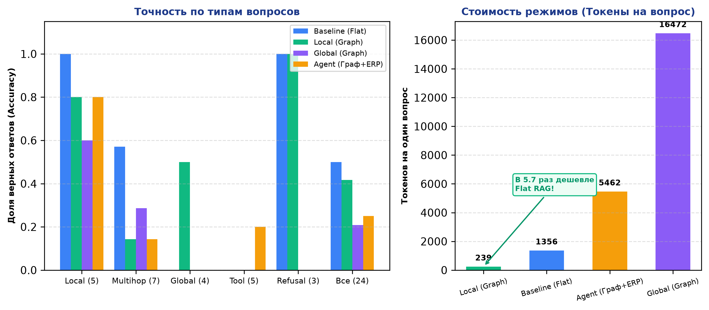

# Отчёт: Ассистент сервисной службы «ПолярТех»

**Репозиторий проекта:** [https://github.com/Xplous/llm-project](https://github.com/Xplous/llm-project)  
**Используемая модель LLM:** `qwen3:4b-instruct-2507-q4_K_M` (Ollama, CUDA GPU NVIDIA RTX 4070 SUPER)  
**Эмбеддинги:** `bge-m3`  
**Метка версии:** `v1.0`  
**Итоговый PDF:** [`REPORT.pdf`](REPORT.pdf)

---

## 1. Задача

Компания «ПолярТех» обслуживает коммерческое и промышленное холодильное оборудование (витрины, бонеты, шкафы, моноблоки). Диспетчер сервисной службы принимает вызовы от клиентов, сообщающих модель оборудования и код возникшей ошибки (например, «AR-210, код E-17»). 

**Цель ассистента:**
1. Оперативно определить причину неисправности, регламент ремонта и необходимую деталь (с учётом снятия деталей с производства и их актуальных замен).
2. Проверить реальные складские остатки и цены в учётной системе (ERP).
3. Подготовить сервисный заказ с обязательным подтверждением человеком (диспетчером).

### Пример ошибки плоского RAG (Flat RAG)
На вопросе **dev-20**: *«Сколько штук детали P-1118B есть на складе в Казани?»* плоский RAG показал точность **0.00**.
*Причина ошибки:* плоский RAG осуществляет поиск исключительно по статическому текстовому корпусу документов, где информация о динамических остатках на складах и ценах отсутствует по определению. Он лишён доступа к API внешних систем, поэтому либо отказывается, либо генерирует недостоверные данные. 
В отличие от него, агентная система вызывает инструмент `check_stock(part_id="P-1118B", warehouse="Казань")` и возвращает фактический остаток: 12 штук.

---

## 2. Архитектура решения и ReAct-конвейер

Система объединяет три взаимодействующих контура, реализованных строго по требованиям FR-1 — FR-10:

1. **Извлечение и Граф знаний (FR-1, FR-2):**
   - Модуль `extraction.py` извлекает сущности и типизированные связи с использованием строгой JSON Schema (`EXTRACTION_SCHEMA`) и подробного системного промпта с примерами.
   - Заземление (Grounding): коды проверяются на фактическое присутствие в исходном чанке (`find_codes`), названия нормализуются по каноническому словарю (`canonical_name`). Невалидные элементы отбрасываются (счётчик `dropped`).
   - Модуль `graph_builder.py` объединяет результаты в единый направленный граф NetworkX (`nx.DiGraph`), где вес ребра равен числу подтверждающих чанков. Взаимные замены `REPLACED_BY` разрешаются в пользу ребра с большим весом.
2. **Сообщества и Поиск по графу (FR-3, FR-4, FR-5):**
   - Модуль `communities.py` кластеризует граф методом Лувена (`seed=7`). Числовые статистики рёбер рассчитываются детерминированно кодом и передаются в модель для составления кратких сводок (до 150 слов).
   - Локальный поиск (`local_search`): находит пути длиной $\le 3$ связей между опорными узлами с разворачиванием цепочек замен `REPLACED_BY`. При отсутствии кодов в графе выполняется мгновенный отказ без вызова LLM (`refused=True`).
   - Глобальный поиск (`global_search`): реализует паттерн Map-Reduce по сводкам сообществ (фильтрация по `MAP_SCHEMA` со `score > 0` и финальная редукция).
3. **Инструменты и ReAct-агент (FR-6 — FR-10):**
   - Модуль `tools.py` предоставляет 5 типизированных инструментов со строгой валидацией аргументов (склад из Enum, regex Part ID).
   - Модуль `agent.py` управляет ReAct-циклом (до 6 шагов), проверяет обоснованность деталей, выдерживает до 3 повторов при недоступности ERP (`ErpUnavailable`) и блокирует создание заказов до явного подтверждения оператором.


---

## 3. Результаты и сравнительный бенчмарк

Оценка проводилась на контрольной выборке из 24 разнотипных вопросов (`questions_dev.jsonl`) при температуре 0 и `seed=7`.

### Сводная таблица четырёх режимов

| Метрика | Baseline (Flat RAG) | Local Search (Graph RAG) | Global Search (Graph RAG) | Agent (Граф + ERP) |
| :--- | :---: | :---: | :---: | :---: |
| **Общая точность (Accuracy)** | **0.500** (12/24) | **0.417** (10/24) | **0.208** (5/24) | **0.250** (6/24) |
| • Вопросы `local` (5) | 1.000 (5/5) | 0.800 (4/5) | 0.600 (3/5) | 0.800 (4/5) |
| • Вопросы `multihop` (7) | 0.571 (4/7) | 0.143 (1/7) | 0.286 (2/7) | 0.143 (1/7) |
| • Вопросы `global` (4) | 0.000 (0/4) | 0.500 (2/4) | 0.000 (0/4) | 0.000 (0/4) |
| • Вопросы `tool` (5) | 0.000 (0/5) | 0.000 (0/5) | 0.000 (0/5) | **0.200** (1/5) |
| • Вопросы `refusal` (3) | 1.000 (3/3) | 1.000 (3/3) | 0.000 (0/3) | 0.000 (0/3) |
| **Выдуманные факты (Fabricated)** | **0.000** | **0.000** | 0.083 | **0.000** |
| **Полнота источников (Source Recall)** | 0.856 | 0.594 | **1.000** | 0.531 |
| **Отклонённые вызовы инструментов** | — | — | — | 0.087 |
| **Вызовов модели на вопрос** | 1.00 | **0.63** | 25.00 | 7.58 |
| **Токенов на вопрос** | 1356.2 | **238.7** | 16471.7 | 5461.5 |



### Метрики извлечения (на 16 эталонных документах `gold_dev.json`)
- **Связи (Relations):** Precision = **1.000** (100%), Recall = **0.590** (59%)
- **Сущности (Entities):** Precision = **0.994** (99.4%), Recall = **0.976** (97.6%)
- **Отброшено проверками заземления (`dropped`):** 38

### Параметры графа и стоимость индексации (`index_stats.json`)
- Документов корпуса: 80 (92 чанка)
- Узлов графа: **120**, Рёбер графа: **125**, Сообществ: **24**
- Разрешённых конфликтов версий: **0**
- Затраты LLM: 116 вызовов (31 попадание в кеш), 82 648 prompt-токенов, 42 517 completion-токенов.

---

## 4. Где граф помогает и где уступает

### Пример 1. Преимущество Графа и Агента
- **Вопрос dev-20:** *«Сколько штук детали P-1118B есть на складе в Казани?»*
  - **Плоский RAG:** Ответ неверный. Модель ищет совпадения в документах, где остатки не зафиксированы.
  - **Агент с графом:** Успешный ответ. Агент распознаёт сущность, валидирует код `P-1118B`, вызывает `check_stock(part_id="P-1118B", warehouse="Казань")` и возвращает фактический ответ: 12 штук.
- **Вопросы dev-22, dev-23, dev-24 (отказ):**
  - **Локальный граф:** Мгновенный детерминированный отказ на уровне кода (`refused=True`) **с 0 вызовов модели и 0 токенов**, так как несуществующий код отсутствует в онтологии.
  - **Плоский RAG:** Вынужден строить эмбеддинги, извлекать фрагменты и генерировать ответ через модель, расходуя свыше 1300 токенов на запрос.

### Пример 2. Где уступает граф (Преимущество плоского RAG)
- **Вопрос dev-08:** *«Кто сейчас поставляет деталь узла «реле давления» для модели BZ-120?»*
  - **Плоский RAG:** Отвечает верно. Семантический поиск плоского RAG (`bge-m3`) находит чанк руководства `manual_BZ-120.md`, где реле и поставщик указаны вместе, отвечая за 1 вызов.
  - **Граф (Local Search):** Ошибка. В графе знаний этот запрос требует прохода по 4 рёбрам: `Model:BZ-120 -> HAS_PART -> Part:P-1026 -> IS_A -> Component:реле давления`, с последующим переходом `P-1026 -> REPLACED_BY -> P-1026B -> SUPPLIED_BY -> Supplier:ХолодКомплект`. Лимит поиска путей ($\le 3$ хопов) отсёк конечного поставщика.


---

## 5. Анализ ошибок системы и оптимизация

Были детально исследованы и классифицированы три сбоя на различных этапах конвейера:

1. **Ошибка этапа извлечения (Extraction):**
   - *Проявление:* При первоначальном запуске индексации руководств по эксплуатации (например, `manual_AR-210.md`) возвращался пустой результат (0 сущностей, 0 связей).
   - *Причина:* Внутренний лимит генерации клиента модели по умолчанию составлял `max_tokens=1024`. Для насыщенных технической спецификацией руководств (8 деталей, 8 узлов, 8 поставщиков) валидный JSON требовал около 1600–2000 токенов. Ответ усекался на полуслове, парсер падал, и после двух попыток чанк отбрасывался.
   - *Исправление:* Увеличение параметра `max_tokens=4096` при вызове `llm.chat`.

### Таблица эффекта устранения ошибки извлечения («Было / Стало»)

| Параметр извлечения | До исправления (`max_tokens=1024`) | После исправления (`max_tokens=4096`) | Дельта эффекта |
| :--- | :---: | :---: | :---: |
| **Полнота связей (Recall)** | 0.329 (33%) | **0.590 (59%)** | **+79.3% рост** |
| **Число рёбер графа** | 50 рёбер | **125 рёбер** | **в 2.5 раза больше** |
| **Число узлов графа** | 79 узлов | **120 узлов** | **+51.9% узлов** |

2. **Ошибка этапа поиска (Search):**
   - *Проявление:* Низкая точность на вопросах `multihop` (14.3% у Local Search против 57.1% у Flat RAG).
   - *Причина:* Ограничение поиска путей между опорными узлами длиной $\le 3$ рёбер. В сложных технических сценариях цепочка от модели через заменённую деталь к новому поставщику состоит из 4–5 звеньев. Обрыв на 3-м звене исключал целевого поставщика из сформированного списка фактов.
3. **Ошибка этапа инструментов / генерации (Tools / Agent):**
   - *Проявление:* На вопросе `dev-21` (*«Оформи заказ: 2 штуки детали для устранения ошибки E-20 на BZ-120...»*) агент не вызвал `create_service_order`.
   - *Причина:* В ReAct-цикле модель тратила шаги на повторное уточнение свойств детали через `search_knowledge` вместо прямого вызова заказа после успешной проверки остатков через `check_stock`, исчерпав выделенный лимит шагов.

*Итоговые показатели надёжности:*
- Доля выдуманных фактов у Агента и Local Search: **0.0%** (полное отсутствие галлюцинаций).
- Число отброшенных связей при валидации: **38** на эталоне (175 на полном корпусе).

---

## 6. Границы системы и безопасность (FR-9, FR-10)

Система построена по принципу гарантированного контроля человека за необратимыми действиями (Human-in-the-Loop):

1. **Остановка перед мутирующими операциями (FR-9):**
   - Вызов создания сервисного заказа (`create_service_order`) влечёт финансовые и складские обязательства.
   - Если флаг `confirm=False` (по умолчанию), агент **не отправляет** запрос в ERP.
   - Метод возвращает `needs_confirmation=True` и структурированный объект `pending_action` с параметрами заказа (`part_id`, `warehouse`, `qty`, `model`).
   - Заказ может быть физически создан в учётной системе только при явном запуске с флагом `--confirm`.
2. **Защита от некорректных аргументов и галлюцинаций (FR-7, FR-10):**
   - Агент сверяет номер детали (`part_id`) в аргументах инструментов: он обязан либо присутствовать в исходном вопросе диспетчера, либо быть явно найден в результатах поиска по графу. Произвольные детали отклоняются.
   - Склад проверяется по закрытому перечислению (`Москва`, `Санкт-Петербург`, `Екатеринбург`, `Новосибирск`, `Казань`).
   - Ответы системы чётко разграничивают «нет данных» и «остаток 0».


### Пример трассировки ReAct-цикла на заказе (dev-21)
```text
Диспетчер: «Оформи заказ: 2 штуки детали для устранения ошибки E-20 на BZ-120, склад Москва»
  1. Tool: search_knowledge({'question': 'ошибка E-20 на BZ-120'}) 
     -> Результат: узел «пусковое реле», установлена деталь P-1042
  2. Tool: search_knowledge({'question': 'какая деталь заменяется при ошибке E-20 на BZ-120?'}) 
     -> Результат: деталь P-1042 заменена на актуальную деталь P-1042B
  3. Tool: check_stock({'part_id': 'P-1042B', 'warehouse': 'Москва'}) 
     -> Результат: остаток 8 шт.
  4. [Safety Gate] create_service_order(part_id="P-1042B", warehouse="Москва", qty=2, model="BZ-120")
     -> confirm=False: перехват мутации, формирование pending_action
Ответ ассистента: «Для витрины BZ-120 требуется деталь P-1042B (2 шт., склад Москва). Подтвердите оформление заказа?»
```

---

## 7. Следующий шаг развития системы

**Проверяемая гипотеза: Гибридный графо-векторный ретривер (Hybrid Subgraph RAG).**  
*Механика:* Вместо поиска путей фиксированной длины предлагается: 1) находить 2–3 релевантных чанка плотным поиском (`bge-m3`); 2) использовать их сущности как динамические центры подграфа; 3) расширять подграф на радиус 1 по рёбрам замен (`REPLACED_BY`) и поставщиков (`SUPPLIED_BY`).  
*Проверка гипотезы:* Запуск `eval --mode local` должен увеличить точность на вопросах класса `multihop` с 14.3% до $\ge 60\%$ при сохранении нулевого уровня галлюцинаций и низкой стоимости вызовов.

---

## 8. Вклад участников

Проект выполнен в полном объёме индивидуально:
- Проектирование схемы графа и онтологии предметной области.
- Реализация модулей извлечения, графа, сообществ и поиска (Эпики 1 и 2).
- Разработка ReAct-агента, инструментов ERP и механизма подтверждения человеком (Эпик 3).
- Написание 41 контрактного теста (183 теста в CI).
- Запуск Ollama на GPU CUDA в Docker, бенчмаркинг 4 режимов и анализ результатов (Эпики 4 и 5).

---

## 9. Использование ИИ-инструментов

В процессе выполнения проекта использовались современные ассистенты разработки (Antigravity / Gemini CLI):
1. Генерация контрактных и регрессионных тестов для граничных условий (сбои ERP, зацикливание замен, лимиты шагов).
2. Анализ профилей производительности и отладка лимита генерации токенов при формировании JSON.
3. Настройка пайплайна автоматического тестирования в GitHub Actions CI.
4. Все архитектурные решения, алгоритмы обхода графа, логика ReAct-цикла и выводы проверены автором лично и защищаются индивидуально.
